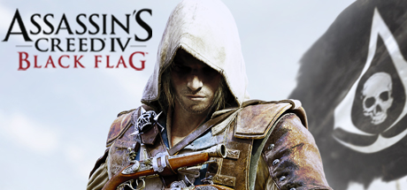

**Assassin's Creed IV: Black Flag is the beloved pirate entry following Captain Edward Kenway across the Caribbean Golden Age of Piracy. Features seamless land and naval combat, shanty collection, treasure hunting, and a genuinely compelling anti-hero protagonist.**

---

## 📖 About

Assassin's Creed IV: Black Flag is the beloved pirate entry following Captain Edward Kenway across the Caribbean Golden Age of Piracy. Features seamless land and naval combat, shanty collection, treasure hunting, and a genuinely compelling anti-hero protagonist.

## ⚠️ Problems Without Trainer

| Problem | Status |
|---------|--------|
| **Naval Resource Grind** — Upgrading the Jackdaw to full requires extensive ship combat | ✅ Solved |
| **Collectible Density** — Animus fragments, chests, and shanties across 50 islands | ✅ Solved |
| **Stealth Escort Missions** — Following targets undetected has very low tolerance for mistakes | ✅ Solved |
| **Fort Conquest** — Capturing all forts requires defeating powerful Man O' War ships | ✅ Solved |

## ✅ Solution

The **Assassin's Creed IV: Black Flag Trainer** solves all these issues by giving you complete control over the game.

## 🎯 Full Feature List

- Unlimited Resources
- God Mode / Invincibility
- Instant Skill Cooldown
- One-Hit Kill
- Freeze Game Timer
- Unlock All Items & Achievements
- Custom Speed Multiplier
- Save State Anywhere

## 🚀 Quick Start

1. **Disable Windows Defender** temporarily (trainer may trigger false positive)
2. Download the trainer from the button above
3. Launch Assassin's Creed IV: Black Flag
4. Run the trainer as Administrator
5. Activate desired cheats with hotkeys

## 💎 Free vs Paid

| Feature | Free | Pro |
|---------|------|-----|
| Basic God Mode | ✅ | ✅ |
| Unlimited Resources | ✅ | ✅ |
| All Advanced Cheats | ❌ | ✅ |
| Auto-Updates | ❌ | ✅ |
| Priority Support | ❌ | ✅ |

## 💻 Requirements

- Windows 10/11 (64-bit)
- Assassin's Creed IV: Black Flag (any version)
- .NET Framework 4.8+
- DirectX 11+

## 🍎 macOS

macOS users can use our alternative tool:

## ⚖️ Legal

This trainer is for educational and single-player use only. Use responsibly.

---

